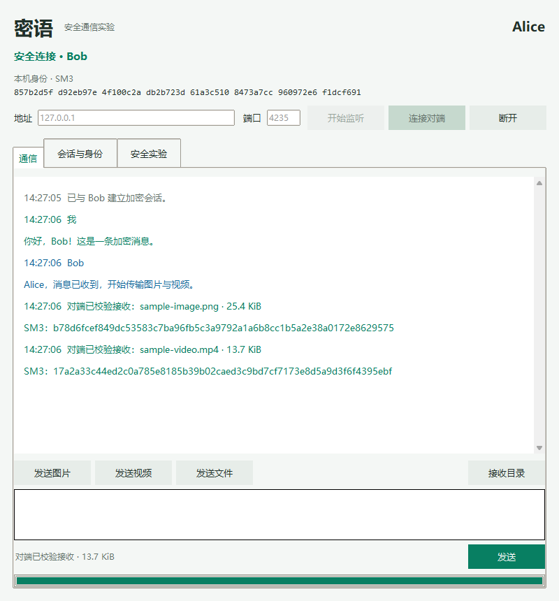
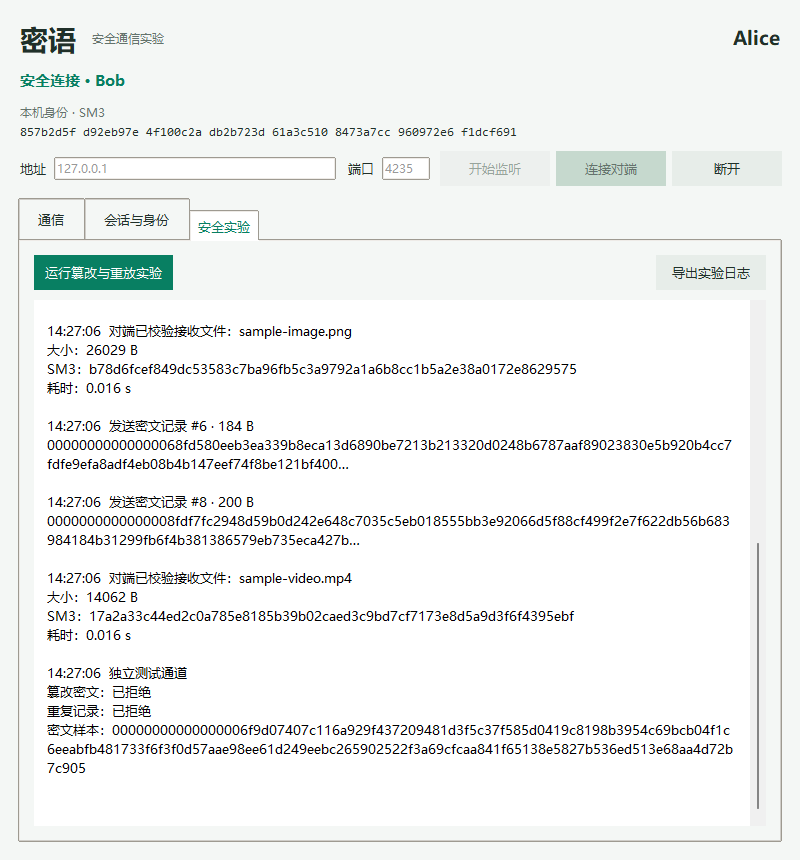

# 密语 SecureChat

基于 SM2 / SM3 / SM4 的 Python 桌面安全通信实验项目。在本机或局域网中，通过 TCP 双向传输文字、图片、视频及普通文件，展示身份认证、会话密钥协商、加密传输、完整性校验和攻击拒绝过程。

**技术栈：** Python 3.12 · Tkinter · TCP Socket · cryptography · gmssl · Pillow · unittest

本项目源自密码学课程实验，适合作为网络安全、密码学应用与 Python 网络编程的学习和展示项目。协议由项目自行组合设计，未经过独立安全审计；包含 X25519 和 AES-GCM，因此不属于全套国密协议，也不应替代成熟的生产通信协议。

## 项目展示

以下截图来自实际运行的自动界面测试，双方使用临时生成的测试身份。

| 加密通信与文件传输 | 篡改与重放实验 |
| --- | --- |
|  |  |

## 已实现功能

- **双端通信：** Alice / Bob 双窗口本机演示，或两台电脑通过局域网直连。
- **身份认证：** SM2 签名绑定握手字段，首次连接交叉核对完整 SM3 公钥指纹，后续拒绝已记录身份的公钥变化。
- **会话密钥：** 每次连接生成 X25519 临时密钥，使用 HKDF-SM3 派生两个方向独立的加密和认证密钥。
- **加密记录：** SM4-CBC + PKCS7，逐记录随机 IV，HMAC-SM3 先认证后解密；连续序号用于拒绝重放和乱序。
- **文件传输：** 64 KiB 分块、流式 SM3 校验、接收确认；支持图片预览，视频以文件形式接收。
- **本地保护：** 使用 scrypt 派生口令保护密钥，通过 AES-256-GCM 加密保存身份私钥。
- **异常处理：** 文件名净化、同名文件避免覆盖、大小限制、正常断连时清理未完成文件。
- **实验与验证：** 独立通道演示密文篡改及消息重放拒绝，提供密码层、真实 TCP 传输与界面测试。

## 快速开始

### 环境要求

- 推荐 Python 3.12，安装时保留 Tcl/Tk 组件。
- 当前验证环境为 Windows 11 / Python 3.12.1；其他系统尚未完整验证，批处理启动脚本仅适用于 Windows。
- 首次安装依赖需要联网；双窗口演示和局域网通信无需外部服务器。

### 安装与启动

~~~powershell
git clone https://github.com/zyx0638/securechat-sm2-sm4.git
cd securechat-sm2-sm4
py -3.12 -m venv .venv
.\.venv\Scripts\python.exe -m pip install -r requirements.txt
.\.venv\Scripts\python.exe main.py --demo
~~~

Windows 也可以先双击 `install.bat`，再双击 `start_demo.bat`。脚本使用 `py -3` 创建环境，请确保对应 Python 版本至少为 3.12。

1. 首次启动设置至少 8 个字符的身份保护口令，再次启动用相同口令解锁。演示中两份独立身份使用同一口令保护。
2. 双窗口演示自动选择本机空闲端口并连接。
3. 交叉核对完整指纹：Alice 的“对端指纹”应等于 Bob 的“本机指纹”，反方向也应一致。通过现场或可信渠道核对后，双方分别点击“已核对，信任此身份”。
4. 显示“安全连接”后发送消息，或选择 `samples/` 中的图片、视频演示文件传输。
5. 在“安全实验”页运行篡改与重放实验；接收到的视频通过本机播放器打开。

### 两台电脑通信

Bob 运行 `start_bob.bat`，以 `0.0.0.0:8765` 开始监听；Alice 运行 `start_alice.bat`，连接 Bob 的实际局域网 IPv4 地址及相同端口。根据系统提示允许对应网络访问，并按上述步骤核验身份。`127.0.0.1` 仅代表本机，不可用于连接另一台电脑。

也可分别运行：

~~~powershell
.\.venv\Scripts\python.exe main.py --name Bob
.\.venv\Scripts\python.exe main.py --name Alice
~~~

## 协议与算法

~~~mermaid
sequenceDiagram
    participant A as Alice / Client
    participant B as Bob / Server
    A->>B: Hello + SM2 签名
    B->>A: Hello + SM2 签名
    Note over A,B: 校验角色、版本、签名，核对或匹配身份指纹
    Note over A,B: X25519 协商 + HKDF-SM3 派生双向密钥
    A->>B: 加密通道内发送 SM2 加密随机挑战
    B->>A: 加密通道内发送 SM2 加密随机挑战
    A->>B: 解密并回显对端挑战
    B->>A: 解密并回显对端挑战
    Note over A,B: 挑战与密钥确认通过后进入通信状态
    A->>B: 序号 + 随机 IV + SM4 密文 + HMAC-SM3
    B->>A: 文件校验后的接收确认
~~~

| 用途 | 实现与约束 |
| --- | --- |
| 身份签名 | SM2；覆盖版本、角色、名称、身份公钥、临时公钥及随机数 |
| 私钥持有验证 | SM2 加密随机挑战；接收方解密并通过加密通道回显，解密补充验证 C3 摘要 |
| 密钥派生 | X25519 + HKDF-SM3；完整握手记录绑定会话，双向密钥分离 |
| 传输加密 | SM4-CBC + PKCS7；每条记录使用新的随机 IV |
| 认证与重放防护 | Encrypt-then-MAC / HMAC-SM3；认证会话、序号、IV 和密文，严格检查连续序号 |
| 文件完整性 | 接收完成后核对大小与流式 SM3 摘要，通过后才作为完整文件保存 |
| 身份文件保护 | scrypt + AES-256-GCM；口令不写入文件，不通过网络发送 |

`gmssl==3.2.2` 适配层使用 `secrets` 提供随机数，保留可能被库误删的公钥前导坐标，并补充曲线点和 C3 摘要检查。核心密码运算调用现有库。

## 测试与实测

运行现有 16 项自动测试：

~~~powershell
.\.venv\Scripts\python.exe -X utf8 -m unittest discover -s tests -v
~~~

运行测试并测量一次本机 8 MiB 文件传输：

~~~powershell
.\.venv\Scripts\python.exe -X utf8 tools/verify_lab.py
~~~

运行真实 Tkinter 界面测试并生成截图：

~~~powershell
.\.venv\Scripts\python.exe -X utf8 tools/gui_smoke.py
~~~

这些命令只需 `requirements.txt` 中的运行依赖。测试使用临时目录和新生成的身份，不读取或修改日常使用的 `runtime/` 身份文件。界面测试会打开桌面窗口，需要可用的图形环境。

**2026-10-30 验证结果：** Windows 11、Python 3.12.1、cryptography 46.0.7。

| 验证项 | 结果 |
| --- | --- |
| 密码与协议自动测试 | 16 项通过，0 失败 |
| 界面测试 | 双向文字、图片与视频传输、图片预览、篡改重放实验通过 |
| 界面与异常行为 | 双窗口无检测到的控件溢出；小窗口布局和发送失败保留草稿检查通过 |
| 单次本机握手 | 约 0.083 秒 |
| 8 MiB 文件传输 | 约 0.258 秒，31.01 MiB/s，接收内容逐字节一致 |

性能数据仅来自一次本机回环测量，不能视为局域网、跨公网或高并发性能保证。原始证据：[测试输出](docs/evidence/tests-output.txt)、[传输测量](docs/evidence/verification.json)、[界面测试](docs/evidence/gui-smoke.json)。重新运行时结果写入 `output/evidence/`，仓库内证据是上述日期的快照。

自动测试覆盖 SM3 标准向量、SM2 签名与密文完整性、错误口令、握手字段篡改与角色反射、双向加密记录、篡改/重放/跨会话/乱序拒绝、帧长度与拆包、身份变化、真实 TCP 文字与文件传输、空文件、同名文件、错误摘要和断连清理等场景。详细设计见 [协议设计](docs/design.md)。

## 目录结构

~~~text
main.py                     # 启动入口、身份解锁和双窗口演示
securechat/
  crypto.py                 # 密码库适配、身份存储、握手与加密记录
  protocol.py               # TCP 帧、会话、信任记录、分块传输和接收确认
  gui.py                    # Tkinter 界面、事件队列与身份核验
tests/                      # 密码与协议测试
samples/                    # 无个人信息的示例文字、图片和短视频
tools/                      # 测试、样本生成、报告生成和课程打包工具
docs/                       # 设计、操作手册、学习资料、截图与验证证据
requirements.txt            # 运行和现有测试的依赖
requirements-dev.txt        # 额外的样本及 Word 报告生成依赖
~~~

网络任务在工作线程中执行，界面通过事件队列回到 Tkinter 主线程更新。

## 数据与使用边界

- `runtime/<身份>/identity.json` 保存口令加密的私钥，`trusted.json` 保存已核验指纹；均已排除出版本管理。不要上传自己的身份文件或解锁口令。
- `runtime/<身份>/received/` 中的已接收文件为可读明文，传输加密不等于接收目录加密。
- 文件上限为 2 GiB，块大小为 64 KiB；单条文字上限为 32 KiB UTF-8。上限来自代码限制，未做 2 GiB 实际传输验证。
- 正常断连或校验失败会清理未完成文件；强制结束进程可能留下 `.partial-*` 文件。
- 口令遗失不能恢复旧私钥。更换身份前应备份原文件，并在对端清除对应旧信任记录，重新通过可信渠道核验完整指纹。
- 当前为单个对端的连接模型，不提供群聊、中继服务、自动公网穿透、断点续传或实时音视频通话。
- 仓库保留源码、示例和技术文档；个人课程报告、评分材料、压缩提交包及运行数据保留在本地。课程报告工具需要先安装开发依赖，并运行验证和界面测试生成 `output/evidence/`，再运行报告与打包工具。

## 更多说明

- [新手操作与测试手册](docs/新手操作与测试手册.md)
- [使用与测试说明](软件使用与测试说明.md)
- [密码学知识点与项目流程图](密码学知识点与项目流程图.md)
- [验收演示与问答](docs/验收演示与问答.md)
- [项目代码学习路线](docs/项目代码学习路线.md)
- [简历项目说明与面试准备](docs/简历项目说明.md)
