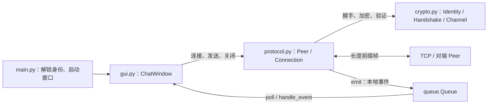
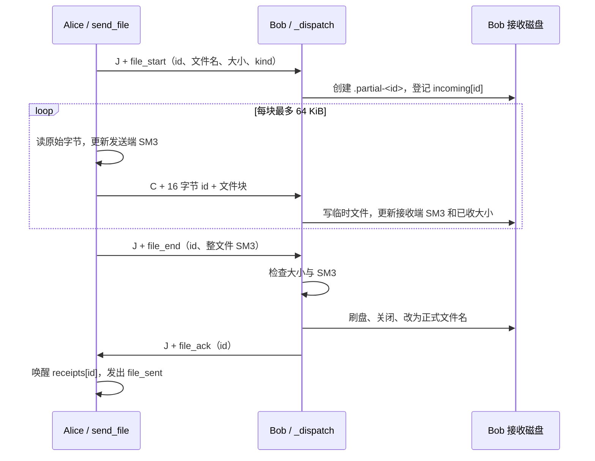

# 项目代码学习路线：模块职责与数据流

本文对照当前源码整理，目标是让你能沿着一次操作，把“谁调用谁、数据变成什么、结果如何回到界面”讲清楚。第一遍先看业务过程，密码算法的数学原理留到后面。

建议分 8 次学习，每次 30～60 分钟；已经熟悉 Python 的部分可以跳过。

## 1. 先建立项目地图

这是一个 Python 桌面点对点通信程序。Alice、Bob 各自拥有身份和 `Peer`，通过 TCP 直接连接；演示模式把两端放在同一个进程的两个窗口中。监听的一端不是中心服务器，连接后双方都能发送。



注意：事件队列是进程内通知方式；TCP 是双方之间的网络传输方式。它们不是同一条通道。

### 核心源码

| 文件 | 负责什么 | 关键对象或函数 | 第一遍关注点 |
| --- | --- | --- | --- |
| `main.py` | 解析参数、解锁/创建身份、创建一个或两个窗口、启动演示连接、退出清理 | `unlock()`、`main()`、内部 `connect_demo()` | 程序从哪里开始，身份怎样传给窗口 |
| `securechat/gui.py` | 输入、按钮、显示、文件选择、首次指纹核验，把后台结果交回主线程 | `ChatWindow`、`run_worker()`、`poll()`、`handle_event()` | 用户操作怎样调用 `Peer`，结果如何显示 |
| `securechat/protocol.py` | TCP 分帧、连接生命周期、调用握手、消息分类、文件分块与回执 | `Peer`、`Connection`、`TrustStore` | 这是串起整个业务的主干 |
| `securechat/crypto.py` | SM2 身份与本地保存、签名与挑战加解密、密钥协商、加密记录 | `Identity`、`Handshake`、`Channel` | 数据什么时候加密，什么时候验证 |
| `securechat/__init__.py` | 标识 Python 包，当前只有说明文字 | 无业务对象 | 可以跳过 |

### 配套文件

| 路径 | 用途 | 什么时候读 |
| --- | --- | --- |
| `tests/test_crypto.py` | 不依赖界面的密码层测试 | 读 `Channel`、`Identity`、`Handshake` 时对照 |
| `tests/test_protocol.py` | 分帧、信任、真实 TCP、文件和失败清理测试 | 跟踪业务流程时对照 |
| `tools/verify_lab.py` | 运行测试并记录一次本机 8 MiB 文件传输测量 | 学完文件传输后选读 |
| `tools/gui_smoke.py` | 创建临时身份，测试实际窗口收发、预览与布局，保存截图 | 学完界面事件队列后选读 |
| `tools/make_samples.py` | 生成演示图片、视频等样本 | 不影响通信主线，可最后读 |
| `tools/build_report.py`、`tools/render_report_windows.ps1` | 生成、渲染实验报告 | 不影响通信主线，可最后读 |
| `tools/package_lab.py` | 打包源码和证据，排除运行身份等数据 | 不影响通信主线，可最后读 |
| `start_demo.bat`、`start_alice.bat`、`start_bob.bat` | 启动对应模式 | 第一次运行时看 |
| `install.bat`、`requirements*.txt`、`run_tests.bat` | 安装依赖、执行测试 | 第一次运行时看 |
| `docs/`、根目录说明文档 | 设计、使用、验收、知识点说明 | 按疑问查阅 |
| `samples/` | 可用于传输的示例文件 | 动手操作时使用 |
| `runtime/` | 真实运行身份、信任记录、接收文件 | 学习保存位置，不需要读取私钥内容 |
| `output/` | 报告及测试证据 | 看实验结果时使用 |
| `.venv/`、`__pycache__/`、`tmp/` | 依赖环境、Python 缓存、临时工作文件 | 第一遍跳过 |

## 2. 记住六个核心对象

| 对象 | 可以怎样理解 | 主要数据 | 生命周期 |
| --- | --- | --- | --- |
| `ChatWindow` | 一个用户窗口 | 输入控件、`events` 队列、对应 `peer` | 窗口打开到关闭 |
| `Peer` | 本端通信控制器 | 身份、收件目录、信任库、当前连接、后台线程 | 通常跟随窗口 |
| `Connection` | 本次连接的状态集合 | `sock`、`channel`、`ready`、`incoming`、`receipts`、锁与停止事件 | 每次监听或连接新建，断开时清理 |
| `Identity` | 长期 SM2 身份 | SM2 公私钥、公钥指纹 | 可加密保存，跨启动复用 |
| `Handshake` | 一次连接的密钥协商过程 | 临时 X25519 私钥、带签名的 `hello` | 每次连接重新创建 |
| `Channel` | 双向安全记录处理器 | 双向加密/认证密钥、会话标识、各方向序号 | 本次连接使用，断开后不再用于新连接 |

补充：`TrustStore` 保存“对端名称 → 已确认指纹”，它和 `Identity` 的私钥文件是两种不同数据。

## 3. 推荐学习顺序

### 第 1 次：跑通功能，建立直观印象（30 分钟）

1. 阅读 `README.md` 的“立即运行”和“文件与密钥保存位置”。
2. 双击 `start_demo.bat`，按提示解锁或创建身份。
3. 首次连接时，在两端交叉核对完整指纹，再分别确认。
4. Alice 给 Bob 发一句话，再反向回复；发送 `samples` 中的一张图片和一个视频。
5. 观察聊天页、会话信息、安全实验日志和接收目录；运行篡改与重放实验。

**本次应能回答：**谁主动连接、谁监听？接收文件保存在什么位置？视频是文件传输还是实时通话？

预期答案：演示中 Alice 连接、Bob 监听；文件进入接收方 `runtime/<身份>/received/`；视频通过普通文件流程传输，图片额外提供本地预览。

### 第 2 次：看启动与对象创建（30～45 分钟）

阅读顺序：

```text
start_demo.bat
→ main.py：if __name__ == "__main__"
→ main()
→ unlock()
→ Identity.load() 或 Identity.generate() + save()
→ ChatWindow.__init__()
→ Peer.__init__()
→ connect_demo()
→ root.mainloop()
```

第一次把 `Identity.load/save` 当作“解锁/保存身份”的黑盒即可。

重点看 `ChatWindow.__init__()`：`self.peer = Peer(..., self.events.put, self.ask_trust)`。这里传入两个回调，解释了协议层如何通知界面、如何请求用户信任。

演示模式中 Bob 用端口 `0` 监听，让操作系统分配可用端口；再把实际端口交给 Alice 连接，不是固定使用某个端口。

**练习：**画出一个窗口对应一个 `Peer`、一个 `Identity` 的关系图；说明演示模式为什么有两个独立身份。

### 第 3 次：跟踪一条文字消息（45～60 分钟，最重要）

暂时假设双方已经进入“安全连接”，先把密码函数当作字节转换函数看。

发送方向的阅读顺序：

```text
gui.py：ChatWindow.send_text()
→ run_worker(self.peer.send_text, text, ...)
→ protocol.py：Peer.send_text()
→ canonical({"type": "text", "text": text})，前面加 b"J"
→ Peer._send()
→ crypto.py：Channel.seal()
→ protocol.py：send_frame()
→ socket.sendall()
```

接收方向的阅读顺序：

```text
Peer._serve() 中的接收循环
→ receive_frame() → receive_exact()
→ Channel.open()
→ Peer._dispatch()
→ emit("text", ...)
→ ChatWindow.events.put(...)
→ ChatWindow.poll()
→ handle_event() 的 "text" 分支
→ append_chat()
```

注意两个同名函数：`ChatWindow.send_text()` 负责取界面输入，`Peer.send_text()` 负责检查并包装协议消息。

**练习：**跟着“你好 Bob”写下每一步的变量名、类型和用途；必须分清 `str`、`dict`、`bytes`。下面第 4 节给出参考答案。

### 第 4 次：理解每条记录怎样保护（45 分钟）

阅读顺序：`canonical()` → `Channel.__init__()` → `seal()` → `open()`。

按实际执行顺序理解：

- `seal()`：限制大小 → 随机 IV → PKCS7 填充 → SM4-CBC 加密 → 拼序号/IV/密文 → HMAC-SM3 → 发送序号加一。
- `open()`：检查记录长度 → 验证 HMAC → 检查期望序号 → SM4-CBC 解密 → 去填充 → 接收序号加一。

对照 `tests/test_crypto.py` 中的 `test_bidirectional_records_and_no_plaintext_on_wire`、`test_tamper_replay_and_cross_session_rejected` 和 `test_out_of_order_and_truncated_records_rejected`。

**练习：**不用 GUI，读懂测试如何创建两端 `Channel`，如何证明篡改和重放会被拒绝。解释为什么先验 HMAC，再解密。

### 第 5 次：回头补齐连接和握手（60 分钟）

阅读顺序：

```text
Peer.listen() → _accept() → _serve(..., "server")
Peer.connect() → _connect() → _serve(..., "client")
→ Handshake.__init__() / validate() / finish()
→ TrustStore.verify()
→ Identity.encrypt() / decrypt()
→ connection.ready = True
```

把 `Peer._serve()` 当作总流程，再进入密码层看具体实现。顺序是：

1. 创建带 SM2 签名的公开握手 `hello`，用长度前缀帧交换。
2. 验证对方角色、字段与签名，计算会话标识。
3. X25519 计算共享秘密，经 HKDF-SM3 派生双向候选密钥，返回 `Channel`。
4. `TrustStore.verify()` 检查已保存指纹；新身份通过回调请求人工确认；同名身份指纹变化则拒绝。
5. 使用对方 SM2 公钥加密随机挑战，再通过 `Channel` 保护后发送。
6. 解密对方挑战并用 `ready` 回显；收到的回显必须等于自己发出的挑战。
7. 设置本端 `ready`，发出 `connected` 事件，进入收取应用消息的循环。

**练习：**说明为什么 `Handshake.finish()` 返回 `Channel` 后仍然不能直接开始聊天；为什么单凭 SM2 签名有效还要核对身份指纹。

### 第 6 次：跟踪文件从磁盘到对方磁盘（60 分钟）

阅读顺序：`ChatWindow.choose_file/send_file()` → `Peer.send_file()` → `_dispatch()` → `_file_start()` → `_file_end()`。

先理解三种数据：文件元信息 `file_start`、二进制块 `C`、结束信息 `file_end`；再补上返回的 `file_ack`。

重点对照 `test_real_tcp_text_binary_empty_and_duplicate_filename`、`test_bad_file_digest_disconnects_and_removes_partial_file`、`test_disconnect_cleans_incomplete_transfer`。

**练习：**用第 6 节的数据流解释：大视频为什么不需要整份读入内存？同名文件如何处理？零字节文件为什么也能传？

### 第 7 次：理解线程、事件与失败清理（45 分钟）

阅读顺序：`run_worker()` → `Peer._start()` → `emit()` → `poll()` → `handle_event()` → `ask_trust()/trust_dialog()` → `close()/_cleanup()/wait_closed()`。

这次重点看控制如何流动：网络线程发送事件，主线程定时消费；首次信任时网络线程等待用户决定，但主线程仍能显示、操作两个窗口。

**练习：**解释为什么 `send_file()` 等待 ACK 时接收循环仍能处理 ACK；说出文件传输失败后在哪里关闭流、删除临时文件、唤醒等待线程。

### 第 8 次：补齐身份保存，并独立复述（45 分钟）

阅读顺序：`Identity.generate()` → `fingerprint` → `save()` → `load()` → `sign()/verify()` → SM2 适配辅助函数。

掌握：长期 SM2 身份、本地口令派生密钥、临时 X25519 密钥和会话流量密钥是不同用途的数据。最后读 `secure_random_hex()`、`sm2_engine()`、`validate_sm2_point()` 和 `decrypt()` 中的 C3 检查，理解本项目对 gmssl 的适配。

**本次产出：**合上源码，用自己的话讲完“启动 → 核验 → 发文字 → 传文件 → 断开”的全过程，再对照下面的清单查漏。

## 4. 一条文字消息到底变成了什么

假设 Alice 发送“你好 Bob”。

| 层次 | 数据示例/结构 | 类型 | 负责函数 |
| --- | --- | --- | --- |
| 界面输入 | `你好 Bob` | `str` | `ChatWindow.send_text()` |
| 业务对象 | `{"type": "text", "text": "你好 Bob"}` | `dict` | `Peer.send_text()` |
| 业务明文字节 | `b'J' + canonical(消息字典)` | `bytes` | `canonical()`、`Peer.send_text()` |
| 加密记录 | `序号(8) + IV(16) + 密文(N) + HMAC(32)` | `bytes` | `Channel.seal()` |
| 网络帧 | `记录长度(4) + 加密记录` | `bytes` | `send_frame()` |
| TCP 字节流 | 上述帧按 TCP 方式传输，不保留应用消息边界 | 字节流 | `socket.sendall()/recv()` |
| 收回的业务对象 | 验证、解密后去掉 `J`，解析 JSON | `dict` | `Channel.open()`、`_dispatch()` |
| 本地界面事件 | `{"type": "text", "peer": "Alice", "text": "你好 Bob"}` | `dict` | `Peer.emit()` |
| 屏幕内容 | Alice 的名字和消息 | 控件显示 | `poll()`、`handle_event()`、`append_chat()` |

括号中的长度单位都是字节。`!I` 是 4 字节网络字节序整数，`!Q` 是 8 字节网络字节序整数。

`canonical()` 实际使用 `ensure_ascii=True`，所以汉字在 JSON 字节中写成 `\uXXXX` 转义；不要把它误认为原始中文字节直接进入加密器。文字大小限制仍按原字符串的 UTF-8 字节数检查。

`J` 表示后面是 JSON 业务数据，`C` 表示文件二进制块；它们都位于加密记录内部，网络上不会以明文业务前缀出现。初始 `hello` 交换则直接使用公开 JSON 帧，不经过 `Channel`。

**发送端的 `text_sent` 只表示本地发送调用成功，不是对端已读回执。** 本项目对文件另有校验回执流程。

## 5. 密钥从哪里来，流向哪里

```text
本地保护：
用户口令 + 随机 salt
  → scrypt → 32 字节保护密钥
  → AES-GCM 加密/解密 SM2 私钥
  → identity.json / 内存中的 Identity

本次连接：
双方带签名的 hello → SM3 → session（公开会话标识）
自己的临时 X25519 私钥 + 对方临时公钥 → shared（共享秘密）
shared + session + 用途标签 → HKDF-SM3 → 96 字节
  → client→server：16 字节 SM4 + 32 字节 HMAC
  → server→client：16 字节 SM4 + 32 字节 HMAC
  → Channel：本端 send_key / receive_key
```

这里的方向按 `client/server` 角色划分；演示里才对应 Alice→Bob 和 Bob→Alice。两台电脑上也可以由 Alice 监听、Bob 主动连接。

需要记住：

- SM2 公钥和握手临时公钥可以传输；SM2 私钥、X25519 私钥、共享秘密和流量密钥不会作为协议字段发给对方。
- SM2 负责签名和小型随机挑战；X25519 + HKDF 负责生成会话密钥；SM4 负责批量业务数据。
- `session` 参与派生与认证，但它本身不是密钥，可以显示在界面。
- 每个方向的挑战记录和 `ready` 记录已经用掉序号 `0`、`1`，所以正常完成握手后，该方向第一条应用记录通常是序号 `2`，不会重新从 `0` 计数。
- `Identity.load()` 解锁后的私钥需要在内存中使用；本地加密保护的是磁盘上的身份文件。

## 6. 文件数据流：不是一次发送整个文件



图中的每条网络业务记录都还要经过 `_send()` → `Channel.seal()` → `send_frame()`；返回方向的 ACK 同样受保护。Bob 在发送 ACK 后发出本地 `file_received` 事件，界面再处理显示和图片预览。

两张状态表是理解文件流程的关键：

| 状态表 | 所在端 | 用什么查找 | 保存什么 |
| --- | --- | --- | --- |
| `connection.incoming` | 接收端 | 文件 `transfer_id` | 临时路径、打开的流、目标大小、已收大小、流式 SM3、媒体类型 |
| `connection.receipts` | 发送端 | 文件 `transfer_id` | `threading.Event` 和确认成功标志 |

`transfer_id` 是 16 字节随机值，JSON 中写成 32 个十六进制字符，文件块中直接放 16 字节原值。它不是会话标识，也不是消息序号。

边界处理：

- 图片、视频、普通文件共用传输路径；`kind` 主要用于显示和决定是否预览图片。
- 空文件没有 `C` 块，但仍发送 `file_start`、空内容 SM3 的 `file_end` 并等待 ACK。
- 文件总大小上限 2 GiB；每端同时只允许一个主动发送任务，接收状态最多登记四个传输。
- `safe_name()` 提取文件名并检查非法名称；正式文件重名时追加编号。
- 大小或摘要失败会抛出异常，连接进入清理，未完成临时文件被删除；正常关闭也会清理。进程被强制终止时可能遗留临时文件。
- 保存到 `received/` 的正式文件是已解密明文。传输加密不等于收到的文件也在磁盘上加密保存。

## 7. 线程和界面事件怎么配合

```text
Tk 主线程：按钮回调
  → run_worker() 创建发送工作线程
  → Peer.send_text()/send_file() 执行发送

Peer 接收工作线程：_serve()
  → 收帧、认证、解密、分发
  → emit(...) → events.put(事件字典)

Tk 主线程：window.after(80, poll)
  → 每轮最多取 150 个事件
  → handle_event() → 更新聊天、日志、进度条
  → 再预约下一轮 poll
```

80 ms 是轮询预约间隔，不是严格的实时刷新保证。文件摘要、网络和密码工作主要在后台进行；图片预览、控件更新在界面主线程进行。启动时的身份解锁发生在主线程。

首次信任是带返回值的特殊交互：

```text
网络线程：TrustStore.verify()
  → ChatWindow.ask_trust()
  → 入队 trust_request，等待 threading.Event
主线程：poll() → trust_dialog() → 用户选择
  → 写 result["accepted"]，调用 decision.set()
网络线程：结束等待 → 继续握手或拒绝连接
```

锁的用途也要分清：`send_lock` 保护单条记录的序号分配和发送，避免多个线程交错；`transfer_lock` 限制主动文件发送任务；`receipt_lock` 保护回执表；`state_lock` 保护当前连接的预留与释放。

关闭路径：`Peer.close()` 设置停止标志并关闭套接字；`_accept/_connect` 的 `finally` 调用 `_cleanup()`，关闭未完成文件、删除临时文件、唤醒 ACK 等待者、解除当前连接，再发出 `disconnected`。`wait_closed()` 用于等待后台线程退出。

## 8. 跟读时推荐设置的断点

以下行号按整理时源码标注；以后源码改动时优先按函数名搜索。

| 想观察什么 | 断点位置 | 观察值/现象 |
| --- | --- | --- |
| 身份怎样交给窗口 | `main.py:56`、`securechat/gui.py:66` | 解锁返回后观察 `identities` 的键、两个窗口各自的 `peer` |
| 输入进入业务层 | `securechat/gui.py:249`、`securechat/protocol.py:244` | `text`、UTF-8 字节数 |
| 加密前后的区别 | `securechat/protocol.py:227`、`securechat/crypto.py:233` | `plaintext` 类型、长度、`packet` 长度 |
| 分帧 | `securechat/protocol.py:33`、`:40` | 4 字节长度、读到的记录长度 |
| 解密后如何分发 | `securechat/protocol.py:305` | `plaintext[:1]`、`message["type"]` |
| 数据如何显示 | `securechat/gui.py:324`、`:335` | `event["type"]`；text/text_sent/file_received 等 |
| 握手为什么还没连上 | `securechat/protocol.py:193`、`:196`、`:216` | 候选通道已生成，但指纹和挑战仍需验证 |
| 文件收到了多少 | `securechat/protocol.py:313`、`:370` | `transfer_id`、`done`、`size`、最终 SM3 |
| 发送方何时认为完成 | `securechat/protocol.py:290`、`:341` | ACK 到达后 `receipt["ok"]`、等待事件变化 |
| 出错后谁清理 | `securechat/protocol.py:415` | incoming 清空、channel 解除、disconnected 事件 |

多线程断点暂停可能触发握手、信任确认或文件 ACK 超时。逐步观察加密记录时，可优先调试不涉及网络的密码层测试；跟踪网络时尽量用少量断点快速继续。

## 9. 用已有测试检查自己的理解

在项目根目录执行：

```powershell
# 第一轮：只看加密记录，不经过 GUI 和真实 TCP
.\.venv\Scripts\python.exe -X utf8 -m unittest discover -s tests -p test_crypto.py -v

# 第二轮：看协议层，包括真实 TCP 文字与文件传输
.\.venv\Scripts\python.exe -X utf8 -m unittest discover -s tests -p test_protocol.py -v

# 最后：运行全部现有测试
.\.venv\Scripts\python.exe -X utf8 -m unittest discover -s tests -v
```

阅读测试时，按“准备什么 → 做什么 → 断言什么 → 在哪里清理”四步读。测试是可执行的调用示例，特别适合理解没有界面参与时 `Peer` 怎么使用。

协议测试中 `lambda *args: True` 是临时测试环境下的信任替身；真实使用时仍要核对指纹。`tools/verify_lab.py` 和 `tools/gui_smoke.py` 则用它们刚生成的对端指纹做精确匹配。

可选：学完主线再运行 `tools/verify_lab.py`、`tools/gui_smoke.py`。它们会向 `output/evidence/` 写入测量结果或截图；第二个脚本还会打开测试窗口，不是纯读取命令。

## 10. 学完后的自测清单

- [ ] 我能解释 `ChatWindow`、`Peer`、`Connection`、`Channel` 的职责差别。
- [ ] 我能顺着函数调用，把一句话从输入框追到对方聊天框。
- [ ] 我能区分业务对象、JSON 明文字节、加密记录、TCP 帧和本地事件。
- [ ] 我知道 TCP 为什么需要 `receive_exact()` 和长度前缀。
- [ ] 我知道长期身份、口令保护密钥、临时协商密钥、会话流量密钥分别用于什么。
- [ ] 我能说明签名验证、指纹核验、SM2 随机挑战分别解决哪个问题。
- [ ] 我知道为什么先验证 HMAC、再检查序号、再解密。
- [ ] 我能解释文件 `id` 如何关联元信息、数据块、结束信息和 ACK。
- [ ] 我知道为什么本地发完文件还不能立即显示“对端已校验接收”。
- [ ] 我能解释网络线程如何通过队列通知主线程，首次信任如何返回用户选择。
- [ ] 我知道断开时在哪清理临时文件和唤醒等待线程。

配套阅读：根目录 `密码学知识点与项目流程图.md` 用于补密码学概念，`软件使用与测试说明.md` 和 `docs/新手操作与测试手册.md` 用于操作问题，`docs/验收演示与问答.md` 用于复述与答辩准备。

第一遍最值得走通的阅读路径是：**`main.py` → `ChatWindow.send_text()` → `Peer.send_text()` → `_send()` → `Channel.seal()` → TCP 分帧 → `Channel.open()` → `_dispatch()` → `poll()/handle_event()`**。走通后，再补握手、文件和错误处理。
