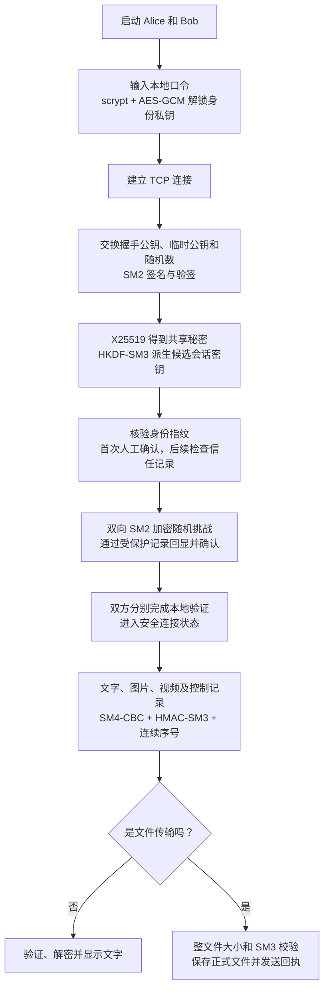
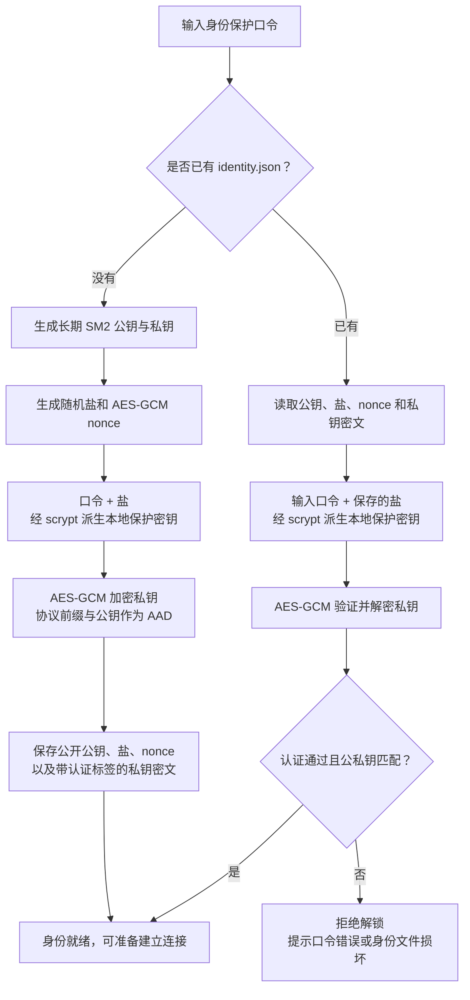
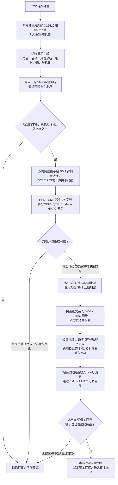
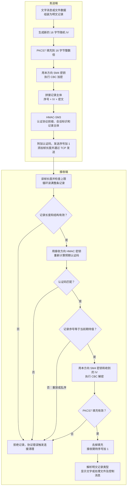
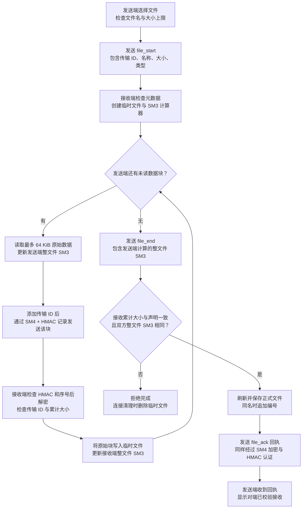

# 密码学知识点与项目流程图

本文根据当前项目的 `main.py`、`securechat/crypto.py` 和 `securechat/protocol.py` 整理。

学习顺序：先读知识表的“是什么”和“为什么”，再看整体流程图，最后结合“怎么做”和源码定位理解实现。第一遍不必研究椭圆曲线公式。

Alice 和 Bob 表示通信双方；本机双窗口演示中，Alice 主动连接，Bob 监听接收连接。双方都可以发送、接收消息和文件。

## 一、知识点总表：是什么、为什么、怎么做

表中的“怎么做”描述本项目的实际做法，不是要求你自己从零编写密码算法。

| 知识点 | 是什么 | 为什么需要 | 本项目怎么做 |
| --- | --- | --- | --- |
| 1. 机密性、完整性、身份认证 | 机密性是内容不被旁观者读懂；完整性是未经授权的修改能被发现；身份认证是确认通信对象 | 只加密不能自动解决篡改和冒充问题 | SM4 负责应用内容保密；HMAC-SM3 认证记录；SM2 签名配合指纹核验认证对端 |
| 2. 对称密钥与会话密钥 | 对称加解密使用同一秘密密钥；会话密钥是本次连接使用的临时秘密材料 | 对大量数据做快速加解密，同时让不同连接使用新的秘密材料 | 每次连接重新协商；Alice→Bob 和 Bob→Alice 分别使用一组加密、认证密钥，不共用一个方向的密钥 |
| 3. 公钥与私钥 | 非对称密码使用的一对相关密钥；公钥可公开，私钥自己保管 | 在不共享身份私钥的情况下完成签名验证或公钥加密 | `Identity.generate()` 生成长期 SM2 身份；对外提供公钥，私钥在本地使用并加密保存 |
| 4. SM2 数字签名 | 私钥生成签名，公钥验证签名与消息是否匹配 | 防止握手参数被替换，并验证发送方持有对应私钥；但仍需确认公钥属于谁 | 对角色、名称、身份公钥、临时公钥、随机数等握手字段签名；收到后验签。签名不隐藏这些字段，也不是“用私钥加密” |
| 5. SM2 公钥加密 | 使用接收者公钥加密，使用对应私钥解密 | 让指定私钥持有者才能恢复随机挑战，检查对端解密能力 | 双方各生成 32 字节随机挑战，用对端 SM2 公钥加密；对端解密后回显。它不负责批量加密视频 |
| 6. SM3 摘要 / Hash | 把任意长度数据计算成固定 256 位、32 字节的摘要；不是可逆加密 | 检查数据是否一致，并为公钥生成方便核验的指纹 | `digest()` 用于公钥指纹、握手摘要等；文件传输时分块更新 SM3，最后比较整份文件的摘要 |
| 7. 身份指纹 | 对身份公钥计算的摘要，相当于这把公钥的简短标识 | 收到一个公钥，并不意味着它就属于想联系的人 | 对原始 SM2 公钥字节计算 SM3；交叉比较“Alice 的对端指纹”和“Bob 的本机指纹”，另一个方向同理 |
| 8. 首次信任与信任记录 | 第一次通过可信渠道核验公钥，之后记住已确认的身份 | 防止首次冒充，并在后续连接时发现同名身份公钥变化 | `TrustStore.verify()` 查询 `trusted.json`；新身份需要用户确认，同名身份的指纹变化则拒绝。首次核对必须认真做 |
| 9. X25519 密钥协商 | 双方交换临时公钥，各自用自己的临时私钥和对方公钥计算共享秘密 | 建立共同秘密，而不把共享秘密直接发送到网络 | `Handshake` 每次创建新的 X25519 临时密钥对；双方调用 `exchange()` 得到相同共享秘密。单独协商不能确认身份，需结合签名和指纹 |
| 10. HKDF-SM3 密钥派生 | 从共享秘密派生指定长度、指定用途的密钥材料 | 避免同一份秘密直接承担所有用途，并区分发送方向与使用场景 | 使用 SM3 的 HKDF，结合会话标识和固定用途标签派生 96 字节；分为两个方向，每方向 16 字节 SM4 密钥与 32 字节 HMAC 密钥 |
| 11. 会话标识与用途隔离 | 会话标识标记本次握手；用途标签区分当前协议与操作场景 | 将密钥派生和认证绑定到本次握手，减少不同会话或用途之间的混用 | 对带固定协议前缀的双方完整握手计算 SM3 得到会话标识；用作 HKDF 的盐，也参与 HMAC 输入。标识不是密钥 |
| 12. SM4 对称加密 | 使用 128 位密钥、128 位分组的对称密码算法 | 快速加密文字、图片和视频的数据块 | `Channel.seal()` 调用密码库的 SM4；`Channel.open()` 在认证和序号检查通过后调用 SM4 解密 |
| 13. CBC 模式 | 将分组密码用于多块数据的一种工作模式；第一块结合 IV，后续块结合前一块密文 | SM4 一次处理 16 字节，需要模式来组织较长消息 | 使用 `SM4-CBC`。CBC 本身不提供消息认证，因此另配 HMAC；本项目没有使用所谓“SM4-GCM” |
| 14. PKCS7 填充 | 把明文补齐到分组长度整数倍的规则；即使恰好整块也要补一块 | CBC 的输入长度必须是 16 字节的整数倍 | 加密前使用 `PKCS7(128)` 填充，解密后验证并去掉填充；128 的单位是位，不是字节 |
| 15. IV：初始化向量 | CBC 加密每条记录时使用的初始输入，不是秘密密钥 | 让相同明文在同一密钥下使用不同随机 IV 时产生不同密文，减少重复模式泄漏 | 每条记录用安全随机源生成 16 字节 IV；随密文公开发送，并纳入 HMAC 保护 |
| 16. HMAC-SM3 消息认证 | 使用秘密认证密钥和 SM3 计算认证码；与普通 SM3 摘要不同 | 检测密文、IV、序号等是否遭到修改或伪造 | 对“协议前缀 + 会话标识 + 序号 + IV + 密文”计算 32 字节认证码；接收端先用 `compare_digest()` 比较认证码，再检查序号和解密 |
| 17. 消息序号与防重放 | 每个方向独立维护的连续计数器，要求收到的序号恰好是下一条 | 一条旧记录即使认证码正确，也不应被重复执行；乱序也应被发现 | 发送时携带 8 字节序号；接收成功后期待序号加 1。握手挑战和确认也使用此计数器，进入聊天后不会重置 |
| 18. 安全随机数与 nonce | 安全随机数难以被预测；nonce 指在特定密钥或上下文下应保持新鲜、避免不当重复的数值，不是一种独立加密算法 | 密钥、挑战、随机 IV、签名随机数等如果可预测或不当复用，可能破坏安全性 | 使用 `secrets`、密码库安全随机源；握手含 32 字节随机数，挑战也为 32 字节。AES-GCM 的 nonce 与握手随机数不是同一个字段 |
| 19. 身份保护口令 | 用户启动时输入的本地解锁口令，不是身份私钥，也不是会话密钥 | 即使别人拿到本地身份文件，也不能直接读取私钥 | 首次设置至少 8 个字符；以后使用相同口令解锁。口令不发送给对端，双方口令不必相同 |
| 20. scrypt 与随机盐 | scrypt 是增加猜测成本的口令派生算法；盐是参与派生的公开随机输入，不是秘密密钥 | 用户口令通常不适合直接当加密密钥；盐能避免相同口令总派生出同一结果 | 使用 16 字节随机盐和 scrypt 派生 32 字节本地保护密钥；参数为 `n=32768, r=8, p=1`。盐与身份密文一起保存 |
| 21. AES-GCM 与附加认证数据 | AES-GCM 同时提供加密和认证；附加认证数据 AAD 被认证但不被加密 | 加密保存长期私钥，并检测文件损坏、口令错误或公钥字段被替换 | 用 scrypt 派生的密钥和 12 字节随机 nonce 加密 SM2 私钥；把协议前缀与公钥作为 AAD。它用于本地身份文件，聊天主体使用 SM4 |
| 22. 规范化编码 | 把相同结构化内容稳定地转换成同一份字节表示 | 字段顺序、空格等编码差异可能导致签名、校验不匹配 | `canonical()` 使用键排序、紧凑 JSON 和固定编码；对确定的字节序列进行签名、摘要或传输 |
| 23. TCP 分帧 | TCP 提供字节流，应用自己确定每条记录的边界；不是加密算法 | 一次接收不一定刚好收到一条完整消息，也可能包含多条的一部分 | 每帧先写 4 字节长度，再写记录；`receive_exact()` 循环读满，`receive_frame()` 检查长度上限。TCP 本身不提供本项目需要的密码保护 |
| 24. 分块传输与整文件校验 | 把大文件逐块传输，并对所有原始字节连续计算摘要 | 避免一次把视频全部读入内存，同时判断是否完整接收 | 每块最多 64 KiB；每块走 SM4 与 HMAC；接收端边写临时文件边更新 SM3，结束时检查大小和摘要；文件上限为 2 GiB |
| 25. 回执 ACK 与完成文件 | ACK 表示接收端已经完成规定的处理；临时文件表示传输尚未完成 | “本地发送完了”不等于“对端已正确保存”；中断文件不应冒充完整文件 | 接收端校验通过后保存正式文件并发送加密认证回执；发送端收到回执才报告对端校验接收。同名文件追加编号，连接清理时删除未完成临时文件 |

## 二、先看项目整体流程

可以先记住一条主线：**解锁身份 → 交换并验签握手 → 协商和派生密钥 → 核验身份指纹 → 完成随机挑战 → 安全收发 → 校验文件。**



这里的“候选会话密钥”表示密钥已经派生，但应用通信还没有获准。源码先派生密钥，再检查指纹，最后进行挑战与密钥确认；不能把“已经算出密钥”直接等同于“安全连接完成”。

握手参数、公钥、随机数和签名以公开握手消息传输。后面的 SM2 挑战密文及其回显，还会进一步放入 SM4 加密、HMAC 认证的记录中。

## 三、本地身份保护流程

对应源码：`main.py` 的 `unlock()`，以及 `crypto.py` 的 `Identity.generate()`、`Identity.save()`、`Identity.load()`。



理解重点：

- `identity.json` 不是把口令明文写进去，也不是把私钥明文写进去。
- 身份私钥在程序解锁后需要在内存中使用；这里保护的是它在磁盘上的保存形式。
- 本机双窗口演示只输入一次口令，是启动工具的便利安排；Alice 和 Bob 仍是两个独立身份。
- 接收目录中的图片和视频是解密后的普通文件，不使用这套身份文件加密流程保存。

## 四、安全连接的握手流程

对应源码：`crypto.py` 的 `Handshake`，`protocol.py` 的 `Peer._serve()`、`TrustStore.verify()`。

下面的“双方”表示 Alice 和 Bob 分别执行相应检查；任意一边拒绝或发生协议错误，都不能正常完成本次连接。



### 派生出的密钥怎样对应

| 方向 | 发送端使用 | 接收端使用 | 每方向长度 |
| --- | --- | --- | --- |
| Alice→Bob | Alice 的发送密钥组 | Bob 的接收密钥组 | 16 字节 SM4 密钥 + 32 字节 HMAC 密钥 |
| Bob→Alice | Bob 的发送密钥组 | Alice 的接收密钥组 | 16 字节 SM4 密钥 + 32 字节 HMAC 密钥 |

同一方向上，双方使用对应的相同秘密材料；两个方向使用不同材料。

### 两种 SM2 操作不要混为一谈

- 签名：自己的私钥签名，对方用签名者的公钥验证，检查握手参数与私钥持有者的关联。
- 公钥加密：用对方的公钥加密挑战，对方用其私钥解密，检查解密能力。
- 两者都不代替首次指纹核验；攻击者也能生成自己的合法密钥对。
- 实现还会验证 SM2 密文的完整性字段 C3；不是得到一段解密结果就直接接受。

## 五、一条消息的发送与接收流程

对应源码：`Peer.send_text()` → `Peer._send()` → `Channel.seal()`；接收端为 `receive_frame()` → `Channel.open()` → `Peer._dispatch()`。

“明文记录”不一定只有用户输入的文字。文字消息会先组装成包含类型和内容的 JSON，并带上内部格式标记；文件数据块和控制消息也使用这套记录保护。



### 网络上传输的记录长什么样

```text
TCP 帧：
[4 字节记录长度] [加密记录]

加密记录：
[8 字节序号] [16 字节 IV] [SM4 密文] [32 字节 HMAC-SM3]

HMAC 输入：
协议前缀 + 会话标识 + 序号 + IV + SM4 密文
```

序号和 IV 可以公开，聊天原文在密文内部。会话标识不作为独立字段重复放入每条记录，而是由双方保存并参与认证计算。外层 4 字节长度头不在上述 HMAC 输入中，由分帧逻辑检查并限制。

### 为什么是这个接收顺序

1. 先检查格式，避免解析明显不合法或过大的记录。
2. 再检查 HMAC，确认记录未遭未经授权的修改；不要先对未认证密文做解密和去填充处理。
3. 再检查序号，拒绝旧记录重复出现或乱序到达。
4. 最后解密、去填充并交给上层解析。通过密码检查也不代表消息类型、文件大小等业务字段可以不再检查。

挑战和 `ready` 各占用一条受保护记录，因此正常完成本项目握手后，每个方向的第一条应用记录通常从序号 **2** 开始。序号不是每个文件重新从零计算，也不是发送完一条文字就重置。

## 六、图片与视频文件传输流程

对应源码：`Peer.send_file()`、`Peer._dispatch()`、`Peer._file_start()`、`Peer._file_end()`、`Peer._cleanup()`。

图片和视频采用相同的加密文件传输机制。区别主要是文件类型标记和界面处理：图片可以生成预览，视频收到后从接收目录用播放器打开。



图中的每一条网络消息，包括 `file_start`、数据块、`file_end` 和 `file_ack`，都复用上一节的记录保护流程，不是只有文件内容加密。

传输途中若发生认证错误、非法文件状态或连接中断，当前传输不能当作完成；连接清理会关闭并删除尚未完成的临时文件。发送端本地读取失败也会使已经开始的传输中止。

**为什么既有 HMAC，又有整文件 SM3？** HMAC 对每条传输记录做认证；整文件 SM3 和大小检查则验证应用层最终组装出的文件是否与发送内容一致。文件摘要本身不证明来源，本项目依靠受认证的记录保护摘要的传输。

## 七、被攻击或操作错误时，哪个环节负责拒绝

| 情况 | 主要检查环节 | 原因 |
| --- | --- | --- |
| 本地口令输错 | scrypt 派生后，AES-GCM 解锁验证失败 | 错误口令不能得到正确保护密钥 |
| 握手中的临时公钥被改掉 | SM2 验签 | 临时公钥是被签名字段的一部分 |
| 攻击者换上自己的合法密钥对 | 首次指纹核验或已有信任记录检查 | 对攻击者自己的公钥验签也可能通过，所以必须确认公钥身份 |
| 同一名称再次出现，但公钥变化 | `TrustStore.verify()` | 保存的指纹与新公钥指纹不匹配 |
| 对端不能正确解密随机挑战 | SM2 解密、挑战回显与密钥确认 | 收到的回显不等于本端随机挑战，或记录认证不能通过 |
| 密文、IV 或序号被改掉 | HMAC-SM3 | 这些字节都在认证范围内 |
| 原封不动重发已接收记录 | 连续序号检查 | HMAC 可能仍正确，但记录序号已过期 |
| 调换两条合法记录的顺序 | 连续序号检查 | 当前记录不等于下一条期待的序号 |
| 把旧会话的记录放进新会话 | 会话绑定的 HMAC 检查 | 新会话的密钥与认证上下文不同 |
| 最终文件缺块、累计大小或摘要不符 | 文件块状态检查，以及 `_file_end()` | 不能仅凭收到结束消息就认定文件完整 |

“安全实验”页的篡改与重放按钮运行的是独立临时测试会话；它展示这些拒绝机制，不会主动破坏正在进行的真实聊天连接。

## 八、从知识点找到源码

| 想学习的内容 | 文件与入口 | 第一遍重点看什么 |
| --- | --- | --- |
| 启动口令和身份创建 | [main.py](main.py)：`unlock()` | 已有身份走加载，新身份走生成和保存 |
| 公钥、私钥与身份指纹 | [securechat/crypto.py](securechat/crypto.py)：`Identity` | 公钥怎样提供给对端，私钥在哪些操作中使用 |
| SM2 签名与公钥加密 | `Identity.sign()`、`verify()`、`encrypt()`、`decrypt()` | 签名和加密分别使用哪把密钥，失败怎样拒绝 |
| scrypt 与 AES-GCM | `Identity.save()`、`load()` | 口令如何派生保护密钥，AAD 如何绑定公钥 |
| X25519 与 HKDF-SM3 | `Handshake.__init__()`、`validate()`、`finish()` | 临时公钥从哪里来，96 字节怎样分配 |
| SM4、填充、HMAC 与序号 | `Channel.seal()`、`open()` | 按顺序对照第五节流程图，不要只看加密调用那一行 |
| 身份信任 | [securechat/protocol.py](securechat/protocol.py)：`TrustStore.verify()` | 首次确认与已有指纹匹配是两个分支 |
| 实际握手执行顺序 | `Peer._serve()` | `handshake.finish()`、信任检查、挑战、`ready=True` 的顺序 |
| 文字消息链路 | `Peer.send_text()`、`_send()`、`_dispatch()` | 用户文字怎样封装，再通过 `Channel` 保护 |
| 图片、视频和文件校验 | `Peer.send_file()`、`_file_start()`、`_file_end()` | 分块、临时文件、摘要、正式保存和回执 |
| 拒绝篡改与重放的演示 | `crypto.py`：`security_demo()` | 先修改记录并测试拒绝，再正常接收，最后重复提交 |

建议第一轮只跟踪一条文字消息：**`send_text()` → `_send()` → `seal()` → 网络 → `open()` → `_dispatch()`**。这一条看懂后，再回头学习握手如何为它准备密钥。

## 九、容易混淆的结论

1. **SM3 不是加密。** 它没有“拿摘要解密回原文”的操作。
2. **签名不是保密。** 验签正确不代表旁观者看不见消息，也不自动证明公钥属于某个现实身份。
3. **HMAC 不是数字签名。** HMAC 使用双方共享的秘密认证密钥，双方都能计算；数字签名使用私钥签、公钥验。
4. **密钥协商不是发送密码。** 双方交换公开参数，在本地计算共享秘密，再派生会话密钥。
5. **会话标识、指纹、盐、IV 都不是秘密密钥。** 它们用途各不相同，不能互相替代。
6. **密码库完成算法运算，项目代码负责正确组合流程。** 验收时既要说明调用什么，也要说明何时验签、何时信任、何时允许解密和交付。
7. **不是所有环节都只用 SM2、SM3、SM4。** 本项目还使用 X25519、HKDF、scrypt 和 AES-GCM，不能称为全套国密协议或国密 TLS。

这些流程图使用 Mermaid 语法。使用支持 Mermaid 的 Markdown 预览器时会显示为图；不支持时会显示图的文本定义，文件本身仍是标准 Markdown 文档。
